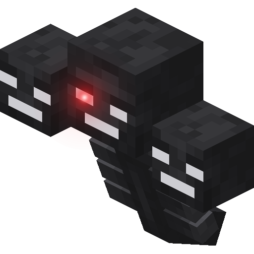

  

<h1 align="center">F7 Enhanced</h1>

  A Fabric client mod for Hypixel SkyBlock: custom menus, HUDs, cosmetics, market tools and an F7 community built in. 
  <b><a href="../../releases/latest">⬇ Download the latest build</a></b>

---

## Install
1. Use **Minecraft 26.2** with **Fabric Loader 0.19.5** or newer. **Java 25** is needed (launchers like Prism set this up for you).
2. Put **[Fabric API](https://modrinth.com/mod/fabric-api)** in your `mods` folder.
3. Download `f7-client-<version>.jar` from the **[latest release](../../releases/latest)** and put it in `mods` too. Keep only one F7 jar there.
4. Launch the game. Right Shift opens the F7 menu.

After that, **F7 updates itself.** New builds download in the background and install the next time you close the game (title screen → ⟳ to turn it off).

## What's inside
- **SkyBlock menus, rebuilt:** Jelly, Holo and more styles for your inventory and every SkyBlock menu, each with its own ⚙ to customize it.
- **Market tools:** Bazaar and auction values everywhere, reward chests that say BUY or SKIP, careful flip checks.
- **HUDs:** slayer and boss cards, stat bars, event timers, dungeon helpers, and a full HUD editor.
- **Your F7 profile:** a nickname, an avatar and an about me. That's how other F7 players see you; your Minecraft name stays hidden.
- **Chat built in:**
  - **F7 IRC:** one chat for every F7 player.
  - **Party chat:** private, and Hypixel never sees it.
  - **F7 Messages:** DMs and group chats.
  - The F7 Discord in a panel, with clean, Jelly and 3D styles.
- **Cosmetics** synced with other F7 players: capes, badges, wings and more.

## Good to know
- **F7 never plays for you.** No macros, no auto-buying: it shows, explains and helps, and you do the playing.
- **Changelogs:** every release below lists everything that changed. They're in the game too (title screen → Changelog).
- **Problems:** report bugs from the game (`/f7d` → Report a bug), which attaches your version and recent errors for you.

Not affiliated with Mojang or Hypixel. This repository holds the public builds only.
